# 性能基准（vfs_bench）

`bench/vfs_bench.cpp` 是一个不依赖第三方库的基准程序，对比直接调用 C / C++ / OS 文件 API 的基线与各种 VFS 后端、分层组合在读、写、元数据操作上的吞吐和延迟。

## 构建与运行

默认不构建，用 `VFS_BUILD_BENCH` 打开。务必使用 Release 构建，Debug 下的数字没有参考价值（程序启动时会提示构建类型）。

```bash
cmake -S . -B build-bench -DCMAKE_BUILD_TYPE=Release -DVFS_BUILD_BENCH=ON -DVFS_BUILD_TESTS=OFF
cmake --build build-bench --target vfs_bench -j
./build-bench/bench/vfs_bench                                  # 全部场景，线程 1,2,4,8,N，热缓存
./build-bench/bench/vfs_bench --filter read.small,archive-lz4  # 只跑名字含任一子串的 "场景/目标"
./build-bench/bench/vfs_bench --scale 0.1 --threads 1,4 --iterations 1   # 快速冒烟
./build-bench/bench/vfs_bench --csv out.csv --md out.md        # 额外输出 CSV / Markdown
./build-bench/bench/vfs_bench --cold --threads 1,8 --filter read.   # 冷缓存（仅 Linux）
```

Windows（MSVC）下用 `cmake --build build-bench --config Release`，可执行文件在 `build-bench/bench/Release/vfs_bench.exe`。

| 选项 | 说明 |
|---|---|
| `--scale <x>` | 数据规模倍数，默认 1：小文件 10000 个 × 4 KiB（放在同一个目录里）、中文件 200 个 × 256 KiB、大文件 64 MiB；随机读次数、写入文件数同比缩放 |
| `--threads <list>` | 线程数列表，`N` 表示硬件线程数，默认 `1,2,4,8,N`（重复的自动去掉） |
| `--iterations <n>` | 每个组合重复次数，取耗时中位数的那一次，默认 3 |
| `--filter <list>` | 逗号分隔的子串，匹配 `场景/目标`，任一命中即运行 |
| `--csv <file>` / `--md <file>` | 额外输出 CSV / Markdown 表格 |
| `--dir <path>` | 工作目录，默认系统临时目录；数据集约 0.5 GB（scale=1：原始文件 154 MiB + 三个归档） |
| `--keep` | 结束后保留数据集 |
| `--cold` | 每次迭代前用 `posix_fadvise(DONTNEED)` 把数据文件逐出页缓存（仅 Linux，不需要 root）；默认先预跑一次再计时（热缓存） |
| `--list` | 列出场景与目标 |

### 场景

每个线程做同样多的工作（弱扩展），总吞吐 = 全部线程的操作数 ÷ 墙钟时间。

| 场景 | 一次操作 |
|---|---|
| `read.small` | 打开 + 读完 4 KiB + 关闭；每个线程读全部小文件，起点错开 |
| `read.medium` | 打开 + 以 64 KiB 分块读完 256 KiB + 关闭 |
| `read.large.seq` | 以 1 MiB 分块顺序读完 64 MiB 大文件，每线程一遍；延迟按块统计 |
| `read.large.rand` | 大文件打开一次，随机偏移读 4 KiB（seek + read，基线 posix 用 `pread`）；打开计入总时间但不计入单次延迟 |
| `meta.open` | 只打开再关闭小文件 |
| `meta.stat` | `stat` 已存在的小文件 |
| `meta.miss` | `exists` 查询大目录中不存在的名字 |
| `meta.list` | 列出含 10000 个文件的目录，每线程 10 次 |
| `write.create` | 每个线程在自己的目录里新建并写入 64 KiB 文件 |
| `write.churn` | 新建写入 4 KiB 文件再删除（一次操作 = 创建 + 删除） |

### 目标

| 目标 | 说明 |
|---|---|
| `base:stdio` | `fopen` / `fread` / `fseeko`；**比值的基准**。`meta.stat`/`miss`/`list` 用 `std::filesystem`（status / exists / directory_iterator） |
| `base:fstream` | `std::ifstream` / `std::ofstream` |
| `base:posix` / `base:win32` | POSIX `open`/`read`/`pread`；Windows 上是 `CreateFileW`/`ReadFile`（带 OVERLAPPED 偏移） |
| `vfs:native` | `NativeBackend` 单独挂载 |
| `vfs:memory` | `MemoryBackend`，预先装入全部数据 |
| `vfs:archive` / `-xor` / `-lz4` | 同一数据集打成的三个归档：明文、全部 XOR 加密、全部 LZ4 压缩（42 MiB，约 3.7:1） |
| `vfs:archive+native` | 归档在下 + 空的本机覆盖目录在上（开发期“本机文件覆盖归档”的用法），同一挂载点 |
| `vfs:memory+archive` | 归档在下 + 空的可写内存层在上 |
| `vfs:3layer` | 归档 + 本机覆盖 + 内存（WriteTarget）三层 |
| `vfs:nested8` | 数据目录挂在 8 级深的路径上，每一级祖先都有一个空的内存挂载（查找要经过 9 层），另有 32 个无关挂载 |

写场景的目标是三个基线、`vfs:native`、`vfs:memory`、`vfs:memory+archive`（写入落到内存层，父目录由 VFS 在写入层创建）。

### 指标

- `ops/s`：操作数 ÷ 墙钟时间；`MiB/s`：读写字节数 ÷ 墙钟时间（元数据场景为 `-`）。
- `p50` / `p99`：所有线程合并后的单次操作延迟（微秒）。
- `vs stdio`：同一场景、同一线程数下吞吐相对 `base:stdio` 的倍数，> 1 表示比 stdio 快。

### 热缓存与冷缓存

- 默认是**热缓存**：先预跑一次，数据都在页缓存里，测到的是 API 与 VFS 本身的开销（系统调用、查找、拷贝、解密、解压）。游戏运行时反复读同一批资源时更接近这种情况。
- `--cold` 在每次迭代前逐出数据文件的页缓存，测到的是首次加载的情况，结果主要取决于存储设备与预读。目录项 / inode 缓存不会被清除（需要 root），所以 `meta.*` 场景在冷缓存下差别不大。macOS / Windows 上 `--cold` 不起作用（可以用重启或 `purge`（macOS）代替）。
- 虚拟机磁盘通常还有一层宿主机缓存，冷缓存数字会比真机的 SSD/HDD 乐观。

## 结果

- 日期：2026-10-21（UTC+8）；命令：`vfs_bench --csv <platform>.csv --md <platform>.md`（默认参数：--scale 1，线程 1/2/4/8/N，3 次取中位数，热缓存），Release 构建。
- 吞吐单位是 ops/s，越高越好；括号内为相对 `base:stdio`（同线程数）的倍数，> 1 表示比直接调用 C 文件 API 快。
- 共享虚拟机（Linux）上的数字有 ±20% 左右的波动，比较时看数量级和趋势。
- 图表由 [`bench/bench_charts.py`](../bench/bench_charts.py) 从 `--csv` 输出生成；全部场景、全部线程数的完整表格见 [Linux](bench/linux.md)、[macOS](bench/macos.md)、[Windows](bench/windows.md)、[iOS](bench/ios.md)。

### Linux

- CPU：Intel Xeon（KVM 虚拟机），8 vCPU；内存 15 GiB
- 系统：Debian 13 (trixie)，Linux 6.12.94
- 编译器：GCC 14.2.0，Release
- 磁盘：virtio 块设备，ext4（工作目录 /tmp）

| 场景 | 线程 | base:stdio | native | memory | archive | archive-lz4 | archive+native | 3layer |
|---|---:|---:|---:|---:|---:|---:|---:|---:|
| read.small | 1 | 336.6k | 385.8k (1.15) | 1.12M (3.33) | 841.6k (2.50) | 401.1k (1.19) | 654.5k (1.94) | 691.4k (2.05) |
| read.small | 8 | 987.4k | 1.27M (1.28) | 3.96M (4.01) | 3.10M (3.14) | 2.23M (2.26) | 3.99M (4.04) | 3.72M (3.76) |
| read.large.rand | 1 | 951.0k | 1.19M (1.25) | 1.79M (1.89) | 817.8k (0.86) | 70.9k (0.07) | 927.1k (0.97) | 1.30M (1.37) |
| read.large.rand | 8 | 6.11M | 7.63M (1.25) | 7.88M (1.29) | 6.03M (0.99) | 386.6k (0.06) | 7.22M (1.18) | 8.04M (1.32) |
| meta.open | 1 | 696.8k | 715.8k (1.03) | 1.94M (2.79) | 2.92M (4.20) | 476.8k (0.68) | 1.27M (1.83) | 1.11M (1.59) |
| meta.open | 8 | 1.02M | 1.18M (1.16) | 3.65M (3.58) | 3.21M (3.16) | 2.04M (2.01) | 3.89M (3.83) | 3.52M (3.46) |
| meta.stat | 1 | 668.0k | 1.23M (1.84) | 2.21M (3.30) | 3.87M (5.79) | 3.86M (5.77) | 1.41M (2.11) | 1.33M (2.00) |
| meta.stat | 8 | 5.00M | 6.11M (1.22) | 6.38M (1.28) | 20.31M (4.06) | 15.60M (3.12) | 9.51M (1.90) | 7.31M (1.46) |
| meta.miss | 1 | 1.40M | 1.32M (0.95) | 2.21M (1.58) | 3.00M (2.15) | 3.04M (2.18) | 1.38M (0.99) | 1.14M (0.82) |
| meta.miss | 8 | 6.06M | 5.03M (0.83) | 5.40M (0.89) | 11.30M (1.87) | 9.95M (1.64) | 4.80M (0.79) | 7.19M (1.19) |
| write.churn | 1 | 98.3k | 76.0k (0.77) | 525.6k (5.35) | - | - | - | - |
| write.churn | 8 | 298.5k | 299.7k (1.00) | 729.5k (2.44) | - | - | - | - |

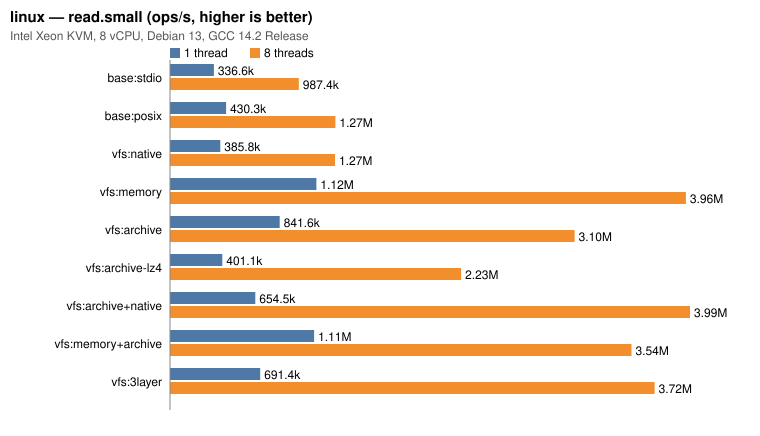

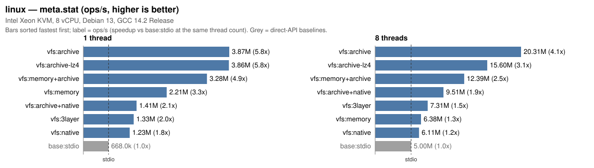

<details><summary>其他场景的柱状图</summary>

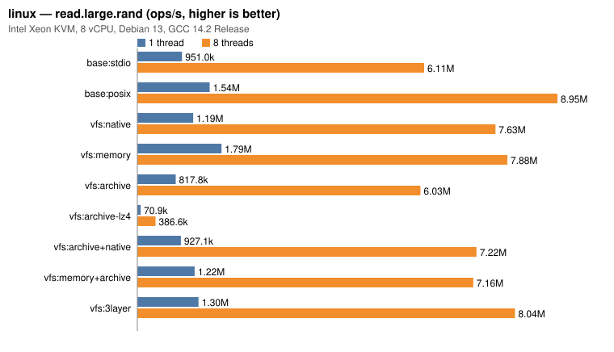

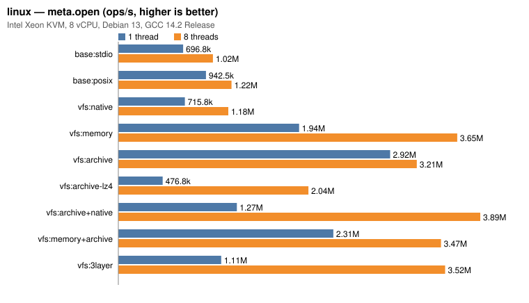

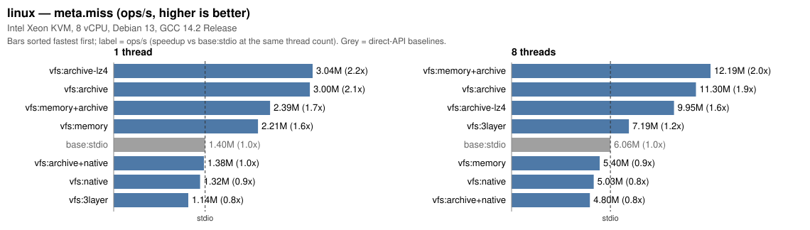

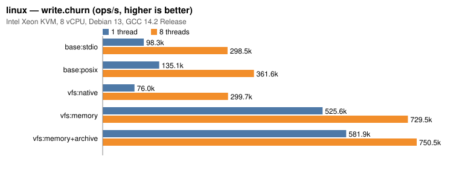

</details>

### macOS

- CPU：Apple M4，10 核；内存 32 GiB
- 系统：macOS 26.5.1
- 编译器：Apple clang 17.0.0，Release
- 磁盘：内置 SSD，APFS

| 场景 | 线程 | base:stdio | native | memory | archive | archive-lz4 | archive+native | 3layer |
|---|---:|---:|---:|---:|---:|---:|---:|---:|
| read.small | 1 | 93.6k | 94.6k (1.01) | 2.99M (31.97) | 1.72M (18.43) | 666.8k (7.12) | 653.2k (6.98) | 640.9k (6.85) |
| read.small | 8 | 125.1k | 127.8k (1.02) | 1.24M (9.92) | 1.38M (11.05) | 1.37M (10.96) | 897.8k (7.18) | 776.7k (6.21) |
| read.large.rand | 1 | 840.6k | 1.53M (1.83) | 4.31M (5.13) | 1.91M (2.27) | 293.3k (0.35) | 2.01M (2.39) | 2.29M (2.73) |
| read.large.rand | 8 | 409.4k | 626.9k (1.53) | 1.88M (4.59) | 1.37M (3.35) | 1.17M (2.85) | 1.35M (3.31) | 1.35M (3.30) |
| meta.open | 1 | 103.1k | 98.4k (0.95) | 3.64M (35.26) | 4.81M (46.67) | 681.3k (6.61) | 867.6k (8.42) | 834.5k (8.10) |
| meta.open | 8 | 126.7k | 128.4k (1.01) | 1.40M (11.03) | 3.09M (24.43) | 1.40M (11.04) | 1.16M (9.19) | 913.5k (7.21) |
| meta.stat | 1 | 433.6k | 733.3k (1.69) | 4.13M (9.52) | 5.86M (13.52) | 5.98M (13.79) | 925.4k (2.13) | 849.7k (1.96) |
| meta.stat | 8 | 614.0k | 1.21M (1.97) | 1.66M (2.71) | 16.18M (26.35) | 16.65M (27.12) | 1.20M (1.95) | 970.4k (1.58) |
| meta.miss | 1 | 1.05M | 865.7k (0.82) | 3.20M (3.04) | 3.61M (3.44) | 3.45M (3.29) | 819.1k (0.78) | 790.8k (0.75) |
| meta.miss | 8 | 1.18M | 1.17M (0.99) | 1.55M (1.31) | 12.95M (10.95) | 11.20M (9.47) | 1.17M (0.99) | 977.0k (0.83) |
| write.churn | 1 | 12.8k | 12.5k (0.97) | 911.9k (71.04) | - | - | - | - |
| write.churn | 8 | 17.3k | 17.1k (0.99) | 288.3k (16.69) | - | - | - | - |

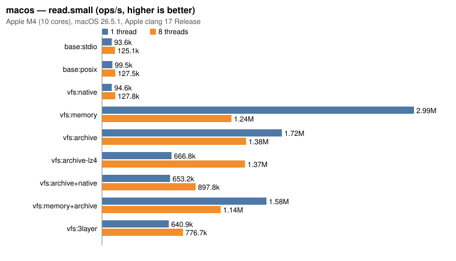

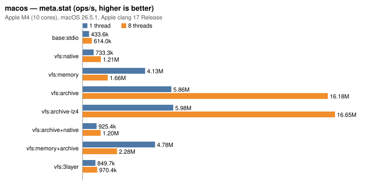

<details><summary>其他场景的柱状图</summary>

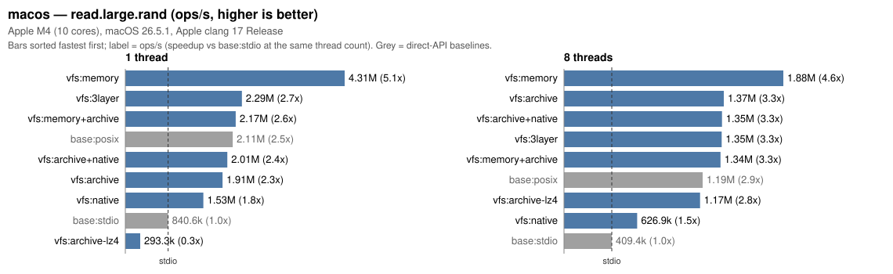

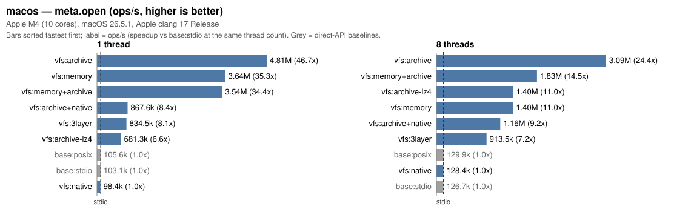

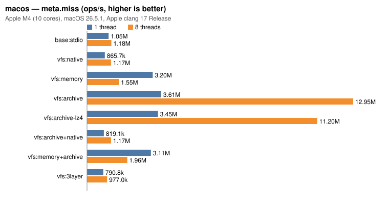

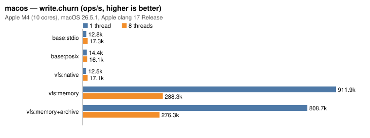

</details>

### Windows

- CPU：Intel Core i5-12400，6 核 12 线程；内存 32 GiB
- 系统：Windows 11 企业版 10.0.26100
- 编译器：MSVC 19.51（VS2026），Release
- 磁盘：Samsung SSD 980 1TB（NVMe），NTFS；Windows Defender 实时保护开启

| 场景 | 线程 | base:stdio | native | memory | archive | archive-lz4 | archive+native | 3layer |
|---|---:|---:|---:|---:|---:|---:|---:|---:|
| read.small | 1 | 40.7k | 40.5k (0.99) | 1.13M (27.79) | 306.2k (7.53) | 236.2k (5.81) | 60.2k (1.48) | 58.1k (1.43) |
| read.small | 8 | 171.6k | 185.1k (1.08) | 3.74M (21.80) | 875.1k (5.10) | 655.0k (3.82) | 256.6k (1.50) | 256.5k (1.50) |
| read.large.rand | 1 | 253.6k | 250.0k (0.99) | 3.03M (11.93) | 224.1k (0.88) | 106.7k (0.42) | 214.2k (0.84) | 195.9k (0.77) |
| read.large.rand | 8 | 303.2k | 308.0k (1.02) | 6.65M (21.94) | 301.8k (1.00) | 352.1k (1.16) | 280.0k (0.92) | 297.5k (0.98) |
| meta.open | 1 | 70.3k | 74.0k (1.05) | 1.17M (16.64) | 2.24M (31.91) | 243.4k (3.46) | 77.6k (1.10) | 75.9k (1.08) |
| meta.open | 8 | 298.0k | 291.0k (0.98) | 4.53M (15.20) | 5.68M (19.07) | 583.7k (1.96) | 324.4k (1.09) | 318.4k (1.07) |
| meta.stat | 1 | 42.3k | 81.2k (1.92) | 1.91M (45.05) | 2.85M (67.22) | 2.94M (69.53) | 81.6k (1.93) | 81.1k (1.92) |
| meta.stat | 8 | 185.0k | 348.3k (1.88) | 4.59M (24.82) | 11.23M (60.71) | 9.56M (51.68) | 313.4k (1.69) | 303.9k (1.64) |
| meta.miss | 1 | 108.3k | 104.9k (0.97) | 1.68M (15.51) | 2.20M (20.35) | 2.14M (19.72) | 83.0k (0.77) | 80.4k (0.74) |
| meta.miss | 8 | 512.4k | 489.1k (0.95) | 4.96M (9.69) | 9.19M (17.94) | 9.34M (18.22) | 329.0k (0.64) | 324.4k (0.63) |
| write.churn | 1 | 1.9k | 1.4k (0.70) | 439.6k (226.52) | - | - | - | - |
| write.churn | 8 | 6.5k | 5.7k (0.86) | 676.3k (103.30) | - | - | - | - |

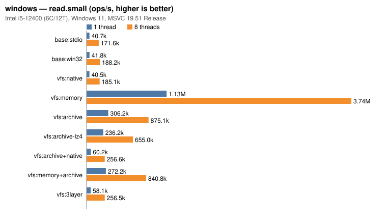

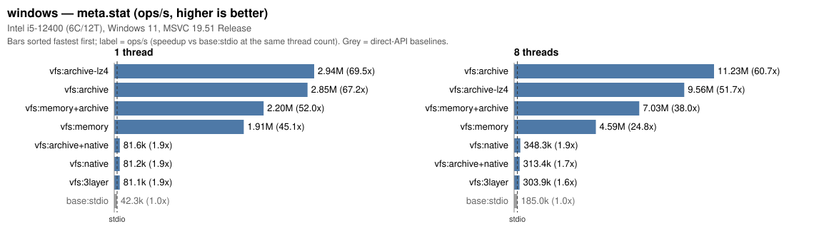

<details><summary>其他场景的柱状图</summary>

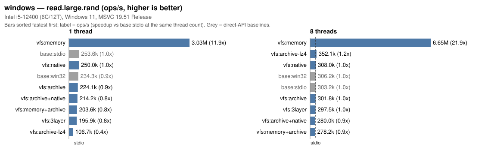

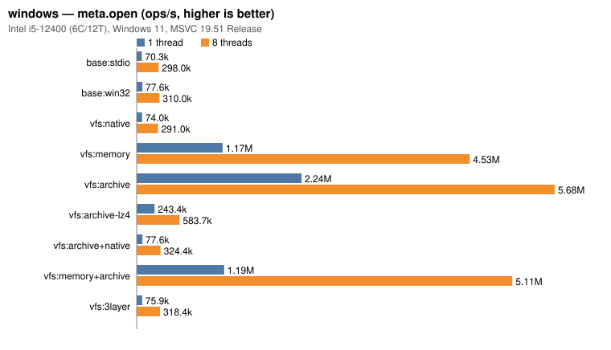

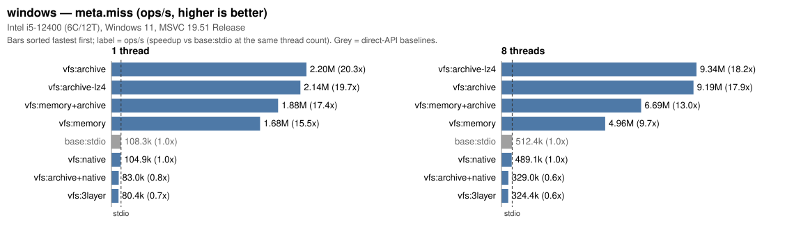

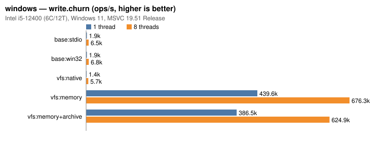

</details>

### iOS

- 设备：iPhone 14 Pro（Apple A16，6 核）；内存 6 GiB
- 系统：iOS 26.5
- 编译器：Apple clang 17.0.0，Release
- 磁盘：内置闪存，APFS（应用沙盒）

| 场景 | 线程 | base:stdio | native | memory | archive | archive-lz4 | archive+native | 3layer |
|---|---:|---:|---:|---:|---:|---:|---:|---:|
| read.small | 1 | 8.0k | 8.1k (1.01) | 2.00M (249.46) | 1.33M (165.32) | 530.0k (66.10) | 71.0k (8.85) | 70.7k (8.82) |
| read.small | 8 | 56.5k | 55.9k (0.99) | 894.8k (15.85) | 1.14M (20.17) | 887.5k (15.72) | 167.6k (2.97) | 157.9k (2.80) |
| read.large.rand | 1 | 359.7k | 760.9k (2.12) | 1.91M (5.31) | 928.3k (2.58) | 128.2k (0.36) | 885.1k (2.46) | 1.16M (3.22) |
| read.large.rand | 8 | 381.6k | 588.5k (1.54) | 1.12M (2.93) | 1.12M (2.93) | 530.2k (1.39) | 1.08M (2.83) | 1.06M (2.79) |
| meta.open | 1 | 27.2k | 27.3k (1.00) | 2.56M (94.20) | 3.61M (132.67) | 517.3k (19.00) | 66.1k (2.43) | 65.8k (2.42) |
| meta.open | 8 | 66.9k | 64.2k (0.96) | 694.8k (10.39) | 2.08M (31.05) | 800.6k (11.97) | 160.8k (2.40) | 142.0k (2.12) |
| meta.stat | 1 | 17.0k | 29.2k (1.72) | 3.20M (188.61) | 4.61M (271.22) | 4.71M (277.44) | 68.5k (4.04) | 68.7k (4.05) |
| meta.stat | 8 | 40.3k | 73.9k (1.83) | 752.9k (18.67) | 6.97M (172.94) | 6.99M (173.34) | 158.5k (3.93) | 144.9k (3.59) |
| meta.miss | 1 | 39.2k | 57.1k (1.46) | 2.33M (59.58) | 2.70M (68.82) | 2.70M (68.93) | 68.5k (1.75) | 68.8k (1.76) |
| meta.miss | 8 | 135.4k | 121.5k (0.90) | 735.4k (5.43) | 5.08M (37.56) | 5.53M (40.83) | 152.7k (1.13) | 145.8k (1.08) |
| write.churn | 1 | 1.5k | 1.7k (1.10) | 701.8k (454.15) | - | - | - | - |
| write.churn | 8 | 2.7k | 2.8k (1.02) | 181.5k (66.40) | - | - | - | - |

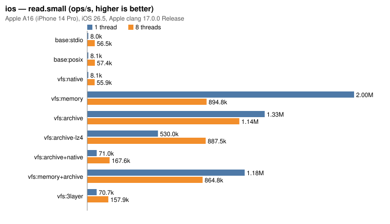

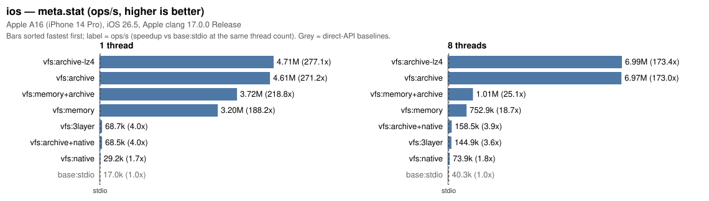

<details><summary>其他场景的柱状图</summary>

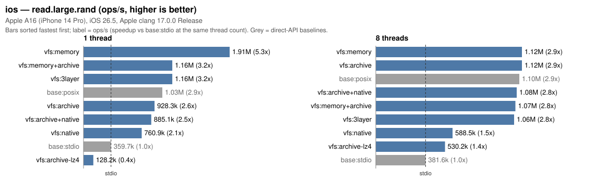

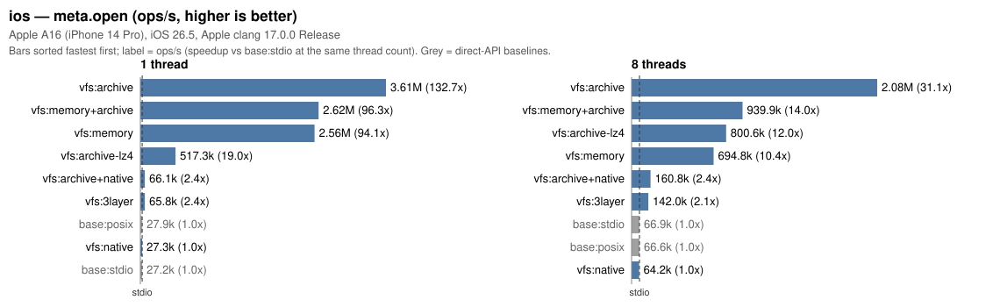

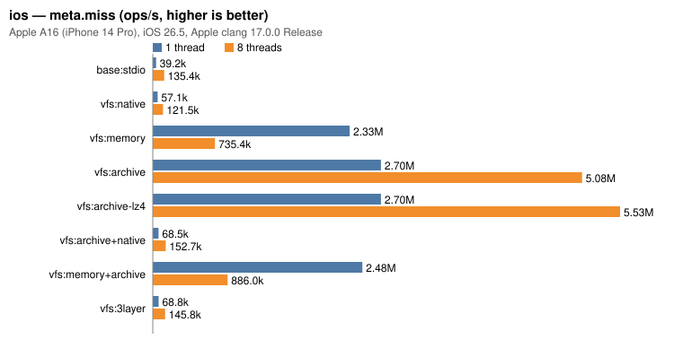

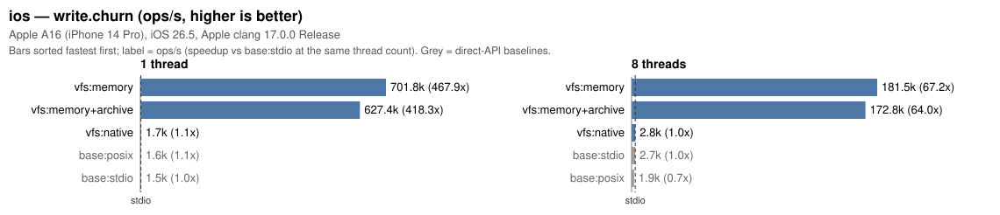

</details>

## 怎么选后端与组合

| 用法 | 推荐 | 依据（上表） |
|---|---|---|
| 发布版只读资源 | 明文或 XOR 归档（`vfs:archive`） | 打开、`stat`、未命中查询都在内存索引里完成。相对 stdio：小文件读取 Linux 2.5 ~ 3.1 倍、macOS 11 ~ 18 倍、Windows 5 ~ 7.5 倍；`meta.open` 分别为 3.2 ~ 4.2、24 ~ 47、19 ~ 32 倍；8 线程同样扩展 |
| 需要压缩 | 只压缩脚本、配置等小文本（`--compress "*.lua"`） | LZ4 条目在打开时整体解压：小文件影响不大，64 MiB 大文件顺序读只有 stdio 的 0.06 ~ 0.3 倍，随机读需要先解压整个文件 |
| 开发期本机覆盖归档 | `archive + native`，仅在开发版挂载 | 每次查找都要先查一次本机目录：未命中查询（`meta.miss`）约 0.64 ~ 0.99 倍；命中归档的文件仍比 stdio 快（`read.small` 1.5 ~ 7 倍）。发布版不要挂空的本机目录 |
| 运行时生成 / 临时数据 | 内存后端（`vfs:memory`），可叠在归档上作可写层 | 没有系统调用：读、`stat`、写入 / 删除大多快数倍到上百倍（`write.churn` 2.4 ~ 226 倍）；Linux 8 线程未命中查询约 0.9 倍 |
| 存档、日志等需要落盘的数据 | 本机目录（`vfs:native`），单独挂载点 | 单层时与直接调用基本持平（读、打开 0.95 ~ 1.3 倍，`stat` 1.2 ~ 1.9 倍）；写入前要确定写入层、检查父目录，创建 + 删除约 0.7 ~ 1.0 倍 |
| 多层叠加 | 尽量少的层；同一路径上不要叠加不必要的空层 | 查找自上而下逐层进行，`nested8`（9 层）元数据操作约 0.4 ~ 1.0 倍 |

其他：
- 列目录（`meta.list`）：归档与内存后端约 1.7 ~ 12.7 倍；本机后端要汇总、去重、排序并转换文件名，约 0.62 ~ 1.04 倍。
- 多线程：所有后端的读和元数据查询都可以并发，挂载表查询不加全局锁；归档每个线程使用独立句柄按偏移读取。

## 重新生成图表

```bash
./build-bench/bench/vfs_bench --csv linux.csv --md linux.md
python3 bench/bench_charts.py --platform linux --input linux.csv --out docs/images/bench --label "CPU, OS, compiler"
```

`--input` 接受 `--csv` 输出或 `--md` 生成的 Markdown 表格；只用 Python 标准库。
