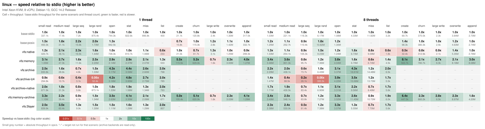
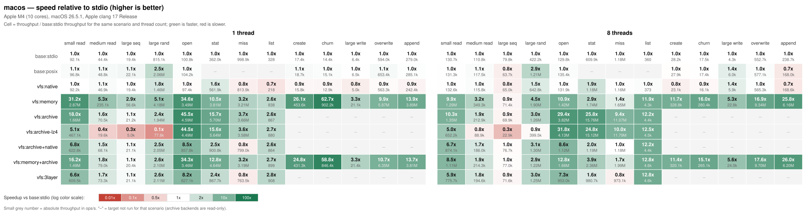
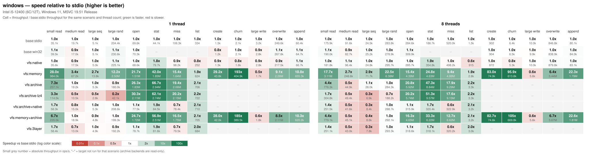
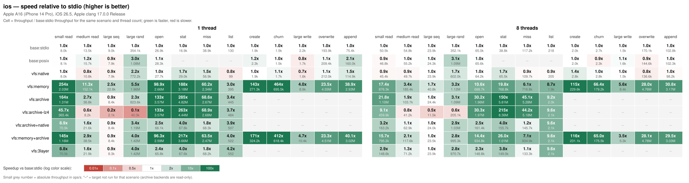
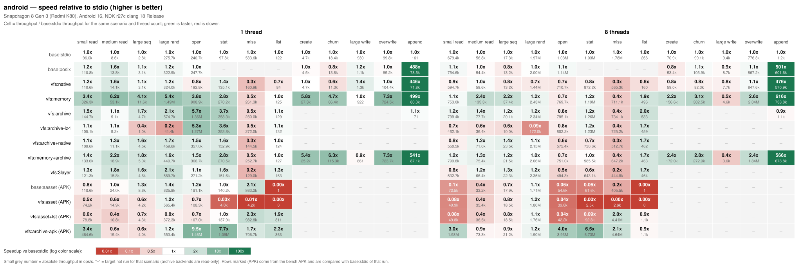
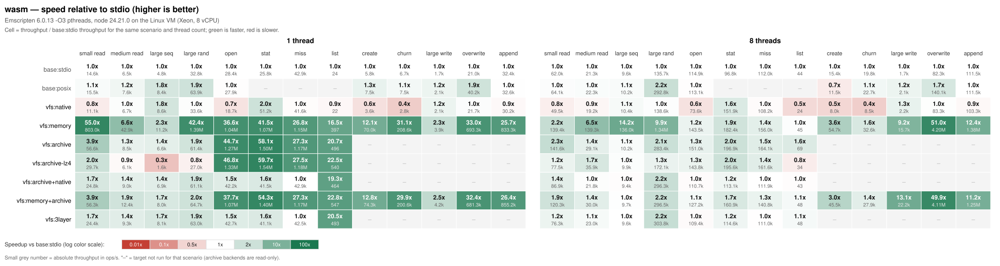

# Performance benchmarks (vfs_bench)

`bench/BenchCore.cpp` (entry point `bench/main.cpp`) is a benchmark with no third-party dependencies. It compares baselines that call the C / C++ / OS file APIs directly with VFS backends and layered combinations, measuring throughput and latency of reads, writes, and metadata operations.

## Build and run

It is not built by default; enable it with `VFS_BUILD_BENCH`. Always use a Release build. Numbers from Debug are not meaningful (the program prints the build type at startup).

```bash
cmake -S . -B build-bench -DCMAKE_BUILD_TYPE=Release -DVFS_BUILD_BENCH=ON -DVFS_BUILD_TESTS=OFF
cmake --build build-bench --target vfs_bench -j
./build-bench/bench/vfs_bench                                  # all scenarios, threads 1,2,4,8,N, warm cache
./build-bench/bench/vfs_bench --filter read.small,archive-lz4  # run only names containing any substring of "scenario/target"
./build-bench/bench/vfs_bench --scale 0.1 --threads 1,4 --iterations 1   # quick smoke
./build-bench/bench/vfs_bench --csv out.csv --md out.md        # also write CSV / Markdown
./build-bench/bench/vfs_bench --cold --threads 1,8 --filter read.   # cold cache (Linux only)
```

On Windows (MSVC) use `cmake --build build-bench --config Release`. The executable is `build-bench/bench/Release/vfs_bench.exe`.

| Option | Description |
|---|---|
| `--scale <x>` | Data-size multiplier, default 1: 10000 small files x 4 KiB (in one directory), 200 medium files x 256 KiB, one 64 MiB file; random-read count and written file count scale the same way |
| `--threads <list>` | Thread-count list. `N` is the hardware thread count. Default `1,2,4,8,N` (duplicates are dropped) |
| `--iterations <n>` | Repetitions per combination; the run with the median elapsed time is kept. Default 3 |
| `--filter <list>` | Comma-separated substrings matched against `scenario/target`; a hit on any one runs it |
| `--csv <file>` / `--md <file>` | Also write a CSV / Markdown table |
| `--dir <path>` | Working directory, default the system temp directory; the dataset is about 0.5 GB (scale=1: 154 MiB of raw files plus three archives) |
| `--keep` | Keep the dataset when finished |
| `--cold` | Before each iteration, drop data files from the page cache with `posix_fadvise(DONTNEED)` (Linux only, no root required); the default is one warmup run then timing (warm cache) |
| `--list` | List scenarios and targets |

### Scenarios

Each thread does the same amount of work (weak scaling). Aggregate throughput = operations across all threads / wall-clock time.

| Scenario | One operation |
|---|---|
| `read.small` | Open + read all 4 KiB + close; each thread reads every small file, with staggered start points |
| `read.medium` | Open + read all 256 KiB in 64 KiB chunks + close |
| `read.large.seq` | Sequentially read the 64 MiB file in 1 MiB chunks, once per thread; latency is per chunk |
| `read.large.rand` | Open the large file once, then read 4 KiB at random offsets (seek + read; the posix baseline uses `pread`); open counts toward total time but not per-operation latency |
| `meta.open` | Open and close a small file, nothing else |
| `meta.stat` | `stat` an existing small file |
| `meta.miss` | `exists` query for a name that is not in a large directory |
| `meta.list` | List a directory of 10000 files, 10 times per thread |
| `write.create` | Each thread creates and writes 64 KiB files in its own directory |
| `write.churn` | Create and write a 4 KiB file, then delete it (one operation = create + delete) |
| `write.large.seq` | Each thread creates its own 64 MiB file and writes it sequentially in 1 MiB chunks (one operation = one chunk; MiB/s is the headline number) |
| `write.overwrite` | Each thread opens its own existing 16 MiB file read/write without truncation (VFS: `OVERLAPPED`; stdio: `r+b`; posix/win32: `O_RDWR` / `OPEN_EXISTING`) once, then writes 4 KiB at random 4 KiB-aligned offsets |
| `write.append` | Each thread repeatedly opens its own log file in append mode, appends 16 x 4 KiB, and closes it (one operation = one 4 KiB append; open/close is amortised over the batch) |

The three handle-based write scenarios run on `base:stdio`, `base:posix` / `base:win32`, and the VFS write targets; `base:fstream` and the read-only archive targets do not take part.

### Targets

| Target | Description |
|---|---|
| `base:stdio` | `fopen` / `fread` / `fseeko`; **the baseline for ratios**. `meta.stat`/`miss`/`list` use `std::filesystem` (status / exists / directory_iterator) |
| `base:fstream` | `std::ifstream` / `std::ofstream` |
| `base:posix` / `base:win32` | POSIX `open`/`read`/`pread`; on Windows, `CreateFileW`/`ReadFile` (OVERLAPPED offsets) |
| `vfs:native` | `NativeBackend` mounted alone |
| `vfs:memory` | `MemoryBackend`, with all data preloaded |
| `vfs:archive` / `-xor` / `-lz4` | Three archives of the same dataset: plaintext, fully XOR-encrypted, and fully LZ4-compressed (44 MiB, about 3.5:1, 64 KiB blocks) |
| `vfs:archive+native` | Archive below + an empty native override directory above (the development "native files override the archive" layout), same mount point |
| `vfs:memory+archive` | Archive below + an empty writable memory layer above |
| `vfs:3layer` | Three layers: archive + native override + memory (WriteTarget) |
| `vfs:nested8` | The data directory is mounted 8 levels deep, with an empty memory mount on every ancestor (lookup crosses 9 layers), plus 32 unrelated mounts |

Write scenarios use the three baselines, `vfs:native`, `vfs:memory`, and `vfs:memory+archive` (writes land in the memory layer; the VFS creates parent directories in the write layer).

### Metrics

- `ops/s`: operations / wall-clock time; `MiB/s`: bytes read or written / wall-clock time (`-` for metadata scenarios).
- `p50` / `p99`: per-operation latency in microseconds after merging all threads.
- `vs stdio`: throughput relative to `base:stdio` for the same scenario and thread count. > 1 means faster than stdio.

### Warm cache and cold cache

- The default is a **warm cache**: one warmup run first, so the data is in the page cache. What is measured is the cost of the API and the VFS itself (system calls, lookup, copies, decryption, decompression). This is closer to a game repeatedly reading the same set of assets.
- `--cold` drops data files from the page cache before each iteration, measuring a first load. Results depend mainly on the storage device and readahead. Directory-entry / inode caches are not cleared (that needs root), so `meta.*` scenarios change little under a cold cache. `--cold` has no effect on macOS / Windows (a reboot, or `purge` on macOS, can stand in).
- VM disks usually have another host cache, so cold-cache numbers are more optimistic than a physical SSD/HDD.

## Results

- Date: 2026-10-21 (UTC+8); command: `vfs_bench --csv <platform>.csv --md <platform>.md` (defaults: --scale 1, threads 1/2/4/8/N, median of 3, warm cache), Release build.
- Throughput is in ops/s, higher is better; the number in parentheses is the multiple of `base:stdio` at the same thread count. > 1 means faster than calling the C file API directly.
- Numbers on the shared VM (Linux) fluctuate by about ±20%. Compare orders of magnitude and trends.
- Charts are generated from `--csv` output by [`bench/bench_charts.py`](../bench/bench_charts.py). Full tables for every scenario and thread count: [Linux](bench/linux.md), [macOS](bench/macos.md), [Windows](bench/windows.md), [iOS](bench/ios.md), [Android](bench/android.md), [WebAssembly](bench/wasm.md).

### Linux

- CPU: Intel Xeon (KVM virtual machine), 8 vCPU; memory 15 GiB
- OS: Debian 13 (trixie), Linux 6.12.94
- Compiler: GCC 14.2.0, Release
- Disk: virtio block device, ext4 (working directory /tmp)

| Scenario | Threads | base:stdio | native | memory | archive | archive-lz4 | archive+native | 3layer |
|---|---:|---:|---:|---:|---:|---:|---:|---:|
| read.small | 1 | 337.1k | 420.7k (1.25) | 1.05M (3.12) | 830.8k (2.46) | 294.8k (0.87) | 671.9k (1.99) | 839.9k (2.49) |
| read.small | 8 | 1.03M | 1.33M (1.29) | 3.46M (3.36) | 2.29M (2.23) | 1.47M (1.43) | 1.71M (1.66) | 2.38M (2.31) |
| read.large.rand | 1 | 875.4k | 1.44M (1.64) | 2.20M (2.51) | 1.33M (1.52) | 52.4k (0.06) | 873.1k (1.00) | 1.30M (1.49) |
| read.large.rand | 8 | 6.17M | 9.23M (1.50) | 7.36M (1.19) | 6.43M (1.04) | 385.5k (0.06) | 6.90M (1.12) | 7.38M (1.20) |
| meta.open | 1 | 744.3k | 728.3k (0.98) | 2.14M (2.88) | 3.17M (4.26) | 3.16M (4.24) | 1.33M (1.79) | 1.11M (1.49) |
| meta.open | 8 | 1.08M | 1.24M (1.15) | 4.04M (3.76) | 3.37M (3.14) | 4.22M (3.92) | 3.31M (3.07) | 3.57M (3.32) |
| meta.stat | 1 | 822.6k | 810.7k (0.99) | 2.37M (2.88) | 3.59M (4.36) | 3.95M (4.80) | 1.58M (1.91) | 1.29M (1.56) |
| meta.stat | 8 | 4.33M | 6.73M (1.55) | 6.79M (1.57) | 18.81M (4.35) | 15.06M (3.48) | 9.56M (2.21) | 5.55M (1.28) |
| meta.miss | 1 | 996.8k | 1.06M (1.07) | 2.07M (2.08) | 2.60M (2.61) | 2.73M (2.74) | 1.34M (1.34) | 1.29M (1.30) |
| meta.miss | 8 | 11.82M | 9.09M (0.77) | 6.74M (0.57) | 14.48M (1.23) | 13.73M (1.16) | 8.49M (0.72) | 7.70M (0.65) |
| write.churn | 1 | 115.3k | 82.3k (0.71) | 538.9k (4.67) | - | - | - | - |
| write.churn | 8 | 344.1k | 310.7k (0.90) | 777.0k (2.26) | - | - | - | - |
| write.large.seq | 1 | 2.6k | 2.7k (1.04) | 1.3k (0.50) | - | - | - | - |
| write.large.seq | 8 | 17.2k | 18.9k (1.10) | 5.9k (0.34) | - | - | - | - |
| write.overwrite | 1 | 1.03M | 995.2k (0.97) | 2.91M (2.83) | - | - | - | - |
| write.overwrite | 8 | 5.01M | 5.67M (1.13) | 10.47M (2.09) | - | - | - | - |
| write.append | 1 | 460.8k | 578.4k (1.26) | 1.46M (3.17) | - | - | - | - |
| write.append | 8 | 3.76M | 3.84M (1.02) | 3.29M (0.88) | - | - | - | - |



### macOS

- CPU: Apple M4, 10 cores; memory 32 GiB
- OS: macOS 26.5.1
- Compiler: Apple clang 17.0.0, Release
- Disk: built-in SSD, APFS

| Scenario | Threads | base:stdio | native | memory | archive | archive-lz4 | archive+native | 3layer |
|---|---:|---:|---:|---:|---:|---:|---:|---:|
| read.small | 1 | 92.1k | 92.2k (1.00) | 2.87M (31.13) | 1.66M (18.06) | 467.1k (5.07) | 622.8k (6.76) | 609.5k (6.61) |
| read.small | 8 | 130.7k | 132.6k (1.01) | 1.29M (9.90) | 1.35M (10.30) | 652.2k (4.99) | 874.1k (6.69) | 775.7k (5.93) |
| read.large.rand | 1 | 815.1k | 1.46M (1.79) | 4.18M (5.13) | 1.94M (2.39) | 77.8k (0.10) | 2.05M (2.51) | 2.11M (2.59) |
| read.large.rand | 8 | 422.2k | 642.8k (1.52) | 1.90M (4.49) | 1.26M (2.97) | 399.5k (0.95) | 1.30M (3.08) | 1.25M (2.97) |
| meta.open | 1 | 100.8k | 97.4k (0.97) | 3.49M (34.57) | 4.59M (45.55) | 4.49M (44.57) | 857.8k (8.51) | 827.1k (8.20) |
| meta.open | 8 | 129.8k | 131.9k (1.02) | 1.42M (10.96) | 3.82M (29.44) | 4.13M (31.82) | 1.12M (8.63) | 953.0k (7.34) |
| meta.stat | 1 | 362.0k | 561.9k (1.55) | 3.81M (10.52) | 5.70M (15.75) | 5.64M (15.57) | 900.8k (2.49) | 867.7k (2.40) |
| meta.stat | 8 | 609.9k | 1.18M (1.93) | 1.74M (2.85) | 15.76M (25.85) | 15.12M (24.79) | 1.19M (1.94) | 980.7k (1.61) |
| meta.miss | 1 | 998.9k | 813.9k (0.81) | 3.21M (3.21) | 3.66M (3.66) | 3.58M (3.59) | 799.0k (0.80) | 763.5k (0.76) |
| meta.miss | 8 | 1.18M | 1.16M (0.98) | 1.65M (1.40) | 11.07M (9.36) | 11.79M (9.97) | 1.18M (1.00) | 973.1k (0.82) |
| write.churn | 1 | 14.4k | 12.9k (0.90) | 902.2k (62.65) | - | - | - | - |
| write.churn | 8 | 17.5k | 16.1k (0.92) | 280.4k (16.02) | - | - | - | - |
| write.large.seq | 1 | 6.4k | 5.0k (0.78) | 21.1k (3.30) | - | - | - | - |
| write.large.seq | 8 | 4.3k | 5.9k (1.37) | 22.8k (5.30) | - | - | - | - |
| write.overwrite | 1 | 594.0k | 563.3k (0.95) | 5.87M (9.88) | - | - | - | - |
| write.overwrite | 8 | 552.7k | 565.3k (1.02) | 9.34M (16.90) | - | - | - | - |
| write.append | 1 | 279.0k | 242.4k (0.87) | 3.89M (13.94) | - | - | - | - |
| write.append | 8 | 238.7k | 168.6k (0.71) | 6.16M (25.81) | - | - | - | - |



### Windows

- CPU: Intel Core i5-12400, 6 cores 12 threads; memory 32 GiB
- OS: Windows 11 Enterprise 10.0.26100
- Compiler: MSVC 19.51 (VS2026), Release
- Disk: Samsung SSD 980 1TB (NVMe), NTFS; Windows Defender real-time protection on

| Scenario | Threads | base:stdio | native | memory | archive | archive-lz4 | archive+native | 3layer |
|---|---:|---:|---:|---:|---:|---:|---:|---:|
| read.small | 1 | 35.1k | 35.6k (1.02) | 984.0k (28.05) | 257.1k (7.33) | 114.5k (3.26) | 58.3k (1.66) | 58.4k (1.66) |
| read.small | 8 | 175.9k | 181.8k (1.03) | 3.11M (17.69) | 776.3k (4.41) | 304.8k (1.73) | 251.5k (1.43) | 251.1k (1.43) |
| read.large.rand | 1 | 204.4k | 225.1k (1.10) | 2.50M (12.23) | 180.0k (0.88) | 42.1k (0.21) | 208.6k (1.02) | 192.2k (0.94) |
| read.large.rand | 8 | 283.8k | 295.7k (1.04) | 6.38M (22.49) | 284.3k (1.00) | 188.2k (0.66) | 288.7k (1.02) | 293.3k (1.03) |
| meta.open | 1 | 69.6k | 68.6k (0.99) | 1.51M (21.68) | 1.83M (26.30) | 2.11M (30.27) | 77.5k (1.11) | 78.7k (1.13) |
| meta.open | 8 | 284.6k | 285.7k (1.00) | 4.39M (15.41) | 5.92M (20.78) | 5.74M (20.15) | 315.9k (1.11) | 318.6k (1.12) |
| meta.stat | 1 | 44.1k | 79.7k (1.81) | 1.85M (42.03) | 2.94M (66.59) | 2.74M (62.21) | 84.5k (1.92) | 81.6k (1.85) |
| meta.stat | 8 | 186.7k | 354.8k (1.90) | 4.63M (24.82) | 8.84M (47.36) | 9.57M (51.25) | 320.4k (1.72) | 318.1k (1.70) |
| meta.miss | 1 | 106.3k | 98.2k (0.92) | 1.64M (15.42) | 2.06M (19.42) | 2.15M (20.24) | 78.4k (0.74) | 79.5k (0.75) |
| meta.miss | 8 | 520.0k | 498.2k (0.96) | 4.88M (9.39) | 9.29M (17.86) | 9.15M (17.59) | 322.9k (0.62) | 320.2k (0.62) |
| write.churn | 1 | 2.1k | 1.6k (0.76) | 404.9k (192.81) | - | - | - | - |
| write.churn | 8 | 6.4k | 5.3k (0.83) | 613.8k (95.91) | - | - | - | - |
| write.large.seq | 1 | 3.2k | 2.8k (0.88) | 1.7k (0.53) | - | - | - | - |
| write.large.seq | 8 | 10.0k | 10.0k (1.00) | 5.6k (0.56) | - | - | - | - |
| write.overwrite | 1 | 249.6k | 217.5k (0.87) | 2.26M (9.05) | - | - | - | - |
| write.overwrite | 8 | 846.8k | 879.8k (1.04) | 5.44M (6.42) | - | - | - | - |
| write.append | 1 | 60.4k | 66.7k (1.10) | 655.3k (10.85) | - | - | - | - |
| write.append | 8 | 80.1k | 83.1k (1.04) | 1.79M (22.35) | - | - | - | - |



### iOS

- Device: iPhone 14 Pro (Apple A16, 6 cores); memory 6 GiB
- OS: iOS 26.5
- Compiler: Apple clang 17.0.0, Release
- Disk: built-in flash, APFS (app sandbox)

| Scenario | Threads | base:stdio | native | memory | archive | archive-lz4 | archive+native | 3layer |
|---|---:|---:|---:|---:|---:|---:|---:|---:|
| read.small | 1 | 8.0k | 8.0k (1.00) | 2.03M (253.75) | 1.31M (163.75) | 365.4k (45.67) | 70.9k (8.86) | 70.5k (8.81) |
| read.small | 8 | 50.5k | 45.4k (0.90) | 876.3k (17.35) | 1.10M (21.78) | 459.9k (9.11) | 163.2k (3.23) | 148.6k (2.94) |
| read.large.rand | 1 | 354.1k | 772.2k (2.18) | 1.96M (5.54) | 823.6k (2.33) | 40.3k (0.11) | 1.19M (3.36) | 1.42M (4.01) |
| read.large.rand | 8 | 352.1k | 602.0k (1.71) | 1.12M (3.18) | 1.09M (3.10) | 205.1k (0.58) | 1.03M (2.93) | 970.7k (2.76) |
| meta.open | 1 | 26.9k | 27.7k (1.03) | 2.66M (98.88) | 3.57M (132.71) | 3.57M (132.71) | 66.1k (2.46) | 65.8k (2.45) |
| meta.open | 8 | 65.0k | 64.2k (0.99) | 688.7k (10.60) | 1.96M (30.15) | 1.97M (30.31) | 161.4k (2.48) | 148.8k (2.29) |
| meta.stat | 1 | 16.9k | 29.0k (1.72) | 3.18M (188.17) | 4.82M (285.21) | 4.44M (262.72) | 67.8k (4.01) | 67.6k (4.00) |
| meta.stat | 8 | 38.8k | 65.5k (1.69) | 768.8k (19.81) | 5.81M (149.74) | 8.36M (215.46) | 155.7k (4.01) | 149.0k (3.84) |
| meta.miss | 1 | 38.9k | 56.9k (1.46) | 2.34M (60.15) | 2.67M (68.64) | 2.68M (68.89) | 68.3k (1.76) | 68.2k (1.75) |
| meta.miss | 8 | 117.2k | 109.7k (0.94) | 716.8k (6.12) | 5.28M (45.05) | 5.18M (44.20) | 145.7k (1.24) | 133.3k (1.14) |
| write.churn | 1 | 1.5k | 1.7k (1.13) | 673.3k (448.87) | - | - | - | - |
| write.churn | 8 | 2.7k | 2.8k (1.04) | 178.7k (66.19) | - | - | - | - |
| write.large.seq | 1 | 2.0k | 1.6k (0.80) | 12.6k (6.30) | - | - | - | - |
| write.large.seq | 8 | 1.5k | 1.6k (1.07) | 9.3k (6.20) | - | - | - | - |
| write.overwrite | 1 | 282.9k | 295.2k (1.04) | 4.18M (14.78) | - | - | - | - |
| write.overwrite | 8 | 136.0k | 135.9k (1.00) | 4.55M (33.46) | - | - | - | - |
| write.append | 1 | 149.1k | 123.3k (0.83) | 3.07M (20.59) | - | - | - | - |
| write.append | 8 | 101.9k | 102.0k (1.00) | 3.17M (31.11) | - | - | - | - |



### Android

- Device: Xiaomi Redmi K80 (24117RK2CC), Qualcomm Snapdragon 8 Gen 3 (SM8650, 8 cores: 1x 3.3 GHz + 3x 3.15 GHz + 2x 2.96 GHz + 2x 2.27 GHz); memory 16 GB
- OS: Android 16 (API 36), HyperOS OS3.0, Linux 6.1
- Compiler: NDK r27c clang 18.0.3, arm64-v8a, Release
- Disk: built-in UFS flash, f2fs (working directory /data/local/tmp, run from `adb shell`)
- Note: a command-line process started from `adb shell` gets no foreground-app CPU boost, so the scheduler often keeps it on slower cores at lower clocks. In-memory paths (memory, archive index) are therefore far below what the same SoC reaches in a foreground app, and multi-thread results vary more than on desktop systems

| Scenario | Threads | base:stdio | native | memory | archive | archive-lz4 | archive+native | 3layer |
|---|---:|---:|---:|---:|---:|---:|---:|---:|
| read.small | 1 | 96.0k | 110.6k (1.15) | 326.3k (3.40) | 144.7k (1.51) | 105.1k (1.09) | 109.6k (1.14) | 121.3k (1.26) |
| read.small | 8 | 679.4k | 594.7k (0.88) | 753.0k (1.11) | 799.4k (1.18) | 462.1k (0.68) | 550.5k (0.81) | 532.7k (0.78) |
| read.large.rand | 1 | 275.7k | 324.0k (1.18) | 1.49M (5.39) | 574.7k (2.08) | 41.4k (0.15) | 459.6k (1.67) | 589.7k (2.14) |
| read.large.rand | 8 | 1.97M | 1.44M (0.73) | 2.43M (1.24) | 2.34M (1.19) | 172.0k (0.09) | 2.15M (1.09) | 2.35M (1.20) |
| meta.open | 1 | 240.7k | 192.8k (0.80) | 908.9k (3.78) | 1.36M (5.63) | 1.27M (5.28) | 357.0k (1.48) | 271.2k (1.13) |
| meta.open | 8 | 1.03M | 710.7k (0.69) | 769.7k (0.75) | 795.1k (0.77) | 802.2k (0.78) | 575.4k (0.56) | 494.3k (0.48) |
| meta.stat | 1 | 97.8k | 135.1k (1.38) | 270.2k (2.76) | 358.3k (3.66) | 353.8k (3.62) | 152.9k (1.56) | 151.6k (1.55) |
| meta.stat | 8 | 1.03M | 872.2k (0.85) | 1.19M (1.15) | 1.26M (1.22) | 1.23M (1.19) | 730.6k (0.71) | 643.1k (0.62) |
| meta.miss | 1 | 533.6k | 160.9k (0.30) | 261.3k (0.49) | 280.0k (0.52) | 272.0k (0.51) | 144.5k (0.27) | 129.0k (0.24) |
| meta.miss | 8 | 1.78M | 565.3k (0.32) | 711.1k (0.40) | 734.1k (0.41) | 725.2k (0.41) | 512.7k (0.29) | 444.8k (0.25) |
| write.churn | 1 | 18.4k | 11.3k (0.61) | 86.4k (4.70) | - | - | - | - |
| write.churn | 8 | 99.1k | 82.3k (0.83) | 302.5k (3.05) | - | - | - | - |
| write.large.seq | 1 | 930 | 1.3k (1.40) | 922 (0.99) | - | - | - | - |
| write.large.seq | 8 | 9.4k | 7.7k (0.82) | 4.6k (0.49) | - | - | - | - |
| write.overwrite | 1 | 99.8k | 104.4k (1.05) | 724.5k (7.26) | - | - | - | - |
| write.overwrite | 8 | 776.3k | 847.6k (1.09) | 2.04M (2.63) | - | - | - | - |
| write.append | 1 | 72.8k | 71.8k (0.99) | 80.3k (1.10) | - | - | - | - |
| write.append | 8 | 570.8k | 570.9k (1.00) | 738.8k (1.29) | - | - | - | - |



### WebAssembly

- Host: the Linux box above (Intel Xeon KVM, 8 vCPU), node v24.21.0
- Compiler: Emscripten 6.0.13, Release (-O3), pthread build, NODERAWFS
- Note: base and native calls go through Emscripten's syscall layer into node's fs API, so system calls cost far more than on native Linux while in-memory paths run as compiled code. Ratios against stdio are therefore much larger than native Linux for 1-thread metadata, and smaller at 8 threads, where proxied file system calls serialize. Details: [WebAssembly](bench/wasm.md)

| Scenario | Threads | base:stdio | native | memory | archive | archive-lz4 | archive+native | 3layer |
|---|---:|---:|---:|---:|---:|---:|---:|---:|
| read.small | 1 | 14.6k | 11.1k (0.76) | 803.0k (55.00) | 56.6k (3.88) | 29.7k (2.03) | 24.8k (1.70) | 24.4k (1.67) |
| read.small | 8 | 62.0k | 49.5k (0.80) | 139.4k (2.25) | 141.6k (2.28) | 77.5k (1.25) | 86.9k (1.40) | 76.3k (1.23) |
| read.large.rand | 1 | 32.8k | 33.6k (1.02) | 1.39M (42.38) | 61.4k (1.87) | 27.0k (0.82) | 61.1k (1.86) | 63.0k (1.92) |
| read.large.rand | 8 | 135.7k | 138.6k (1.02) | 1.34M (9.87) | 283.4k (2.09) | 172.1k (1.27) | 296.3k (2.18) | 303.8k (2.24) |
| meta.open | 1 | 28.4k | 18.7k (0.66) | 1.04M (36.62) | 1.27M (44.72) | 1.33M (46.83) | 42.2k (1.49) | 42.7k (1.50) |
| meta.open | 8 | 114.9k | 73.6k (0.64) | 143.5k (1.25) | 151.0k (1.31) | 143.8k (1.25) | 110.7k (0.96) | 109.4k (0.95) |
| meta.stat | 1 | 25.8k | 51.2k (1.98) | 1.07M (41.47) | 1.50M (58.14) | 1.54M (59.69) | 41.5k (1.61) | 41.1k (1.59) |
| meta.stat | 8 | 96.8k | 151.9k (1.57) | 182.4k (1.88) | 196.9k (2.03) | 195.6k (2.02) | 113.1k (1.17) | 114.6k (1.18) |
| meta.miss | 1 | 42.9k | 41.6k (0.97) | 1.15M (26.81) | 1.17M (27.27) | 1.18M (27.51) | 42.9k (1.00) | 42.5k (0.99) |
| meta.miss | 8 | 112.0k | 108.2k (0.97) | 156.0k (1.39) | 164.1k (1.47) | 161.6k (1.44) | 111.9k (1.00) | 111.0k (0.99) |
| write.churn | 1 | 6.7k | 2.8k (0.42) | 208.6k (31.13) | - | - | - | - |
| write.churn | 8 | 19.8k | 8.5k (0.43) | 32.6k (1.65) | - | - | - | - |
| write.large.seq | 1 | 1.7k | 2.1k (1.24) | 3.9k (2.29) | - | - | - | - |
| write.large.seq | 8 | 1.7k | 2.2k (1.29) | 15.7k (9.24) | - | - | - | - |
| write.overwrite | 1 | 21.0k | 21.7k (1.03) | 693.3k (33.01) | - | - | - | - |
| write.overwrite | 8 | 82.3k | 83.3k (1.01) | 4.20M (51.03) | - | - | - | - |
| write.append | 1 | 32.4k | 30.2k (0.93) | 833.3k (25.72) | - | - | - | - |
| write.append | 8 | 111.5k | 103.3k (0.93) | 1.38M (12.38) | - | - | - | - |



## Choosing backends and combinations

| Use | Recommendation | Basis (tables above) |
|---|---|---|
| Shipping read-only assets | Plaintext or XOR archive (`vfs:archive`) | Open, `stat`, and miss queries are served from the in-memory index. Versus stdio: small-file reads are 2.2-2.5x on Linux, 10-18x on macOS, 4.4-7.3x on Windows; `meta.open` is 3.1-4.3x, 29-46x, and 21-26x respectively |
| Compression needed | Compress small text such as scripts and config (`--compress "*.lua"`); keep large binary assets uncompressed | LZ4 entries are stored in blocks (64 KiB by default) and opening does no decompression, but each read decodes the whole block it touches: sequential reads of a 64 MiB LZ4 file are 0.22-0.58x of stdio on native platforms, and 1-thread 4 KiB random reads 0.06-0.21x. A smaller `--block-size` reduces the work per random read |
| Native override of the archive during development | `archive + native`, mounted only in development builds | Every lookup checks the native directory first: miss queries (`meta.miss`) are 0.27-1.76x; files that hit the archive read at 0.81-8.9x. Do not mount an empty native directory in a shipping build |
| Runtime-generated / temporary data | Memory backend (`vfs:memory`), optionally stacked on an archive as a writable layer | No system calls: `write.churn` is 1.7-449x; large sequential writes 0.34-9.2x; an 8-thread miss query on Linux is about 0.6x |
| Data that must hit disk, such as saves and logs | Native directory (`vfs:native`), its own mount point | A single layer is close to a direct call: small reads 0.76-1.29x, opens 0.64-1.15x, `stat` 0.85-2.0x, in-place overwrites 0.87-1.13x, appends 0.71-1.26x, create + delete 0.42-1.13x (lowest under WebAssembly) |
| Stacking layers | As few layers as possible; do not stack needless empty layers on the same path | Lookup walks layers top-down. `nested8` (9 layers) opens are 0.26-1.25x and misses 0.18-1.53x |

Other:
- Directory listing (`meta.list`): archive and memory backends are about 1.0-21x; the native backend must merge, deduplicate, sort, and convert names, about 0.55-1.04x.
- Threads: reads and metadata queries are concurrent on every backend, and mount-table lookup takes no global lock; each archive thread reads by offset on its own handle.
- Write scenarios settle the disk first: before each timed write iteration (outside the timing) every file in the write area and the generated dataset is flushed (`FlushFileBuffers` / `fsync`) and the previous iteration's files are removed, so no target starts behind another target's dirty-page backlog. Under WebAssembly the flush is a no-op. The write rows on every platform come from a `--filter write` run with this step.
- `vfs:memory` large sequential writes (0.34-0.56x on Linux and Windows; 3.3-5.3x on macOS) are bound by page faults on freshly allocated memory and by copying when the buffer doubles; file data is kept contiguous.

## Regenerating charts

```bash
./build-bench/bench/vfs_bench --csv linux.csv --md linux.md
python3 bench/bench_charts.py --platform linux --input linux.csv --out docs/images/bench --label "CPU, OS, compiler"   # writes docs/images/bench/linux.svg
```

`--input` accepts `--csv` output or the Markdown table produced by `--md`; only the Python standard library is used.
