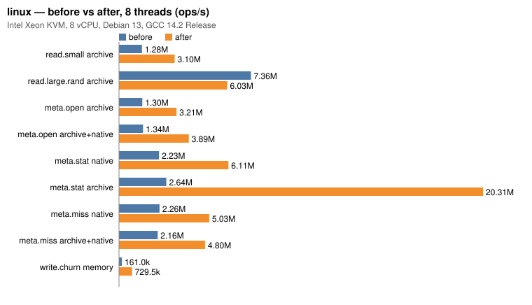
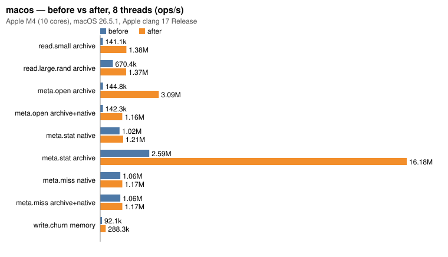
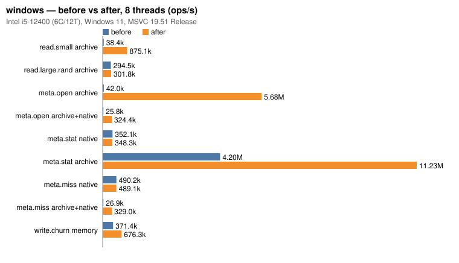

# 性能基准（vfs_bench）

`bench/vfs_bench.cpp` 是一个不依赖第三方库的基准程序，对比直接调用 C / C++ / OS 文件 API 的基线与各种 VFS 后端、分层组合在读、写、元数据操作上的吞吐和延迟。

## 构建与运行

默认不构建，用 `VFS_BUILD_BENCH` 打开。务必使用 Release 构建，Debug 下的数字没有参考价值（程序启动时会提示构建类型）。

```bash
cmake -S . -B build-bench -DCMAKE_BUILD_TYPE=Release -DVFS_BUILD_BENCH=ON -DVFS_BUILD_TESTS=OFF
cmake --build build-bench --target vfs_bench -j
./build-bench/bench/vfs_bench                                  # 全部场景，线程 1,2,4,8,N，热缓存
./build-bench/bench/vfs_bench --filter read.small,archive-lz4  # 只跑名字含任一子串的 "场景/目标"
./build-bench/bench/vfs_bench --scale 0.1 --threads 1,4 --iterations 1   # 快速冒烟
./build-bench/bench/vfs_bench --csv out.csv --md out.md        # 额外输出 CSV / Markdown
./build-bench/bench/vfs_bench --cold --threads 1,8 --filter read.   # 冷缓存（仅 Linux）
```

Windows（MSVC）下用 `cmake --build build-bench --config Release`，可执行文件在 `build-bench/bench/Release/vfs_bench.exe`。

| 选项 | 说明 |
|---|---|
| `--scale <x>` | 数据规模倍数，默认 1：小文件 10000 个 × 4 KiB（放在同一个目录里）、中文件 200 个 × 256 KiB、大文件 64 MiB；随机读次数、写入文件数同比缩放 |
| `--threads <list>` | 线程数列表，`N` 表示硬件线程数，默认 `1,2,4,8,N`（重复的自动去掉） |
| `--iterations <n>` | 每个组合重复次数，取耗时中位数的那一次，默认 3 |
| `--filter <list>` | 逗号分隔的子串，匹配 `场景/目标`，任一命中即运行 |
| `--csv <file>` / `--md <file>` | 额外输出 CSV / Markdown 表格 |
| `--dir <path>` | 工作目录，默认系统临时目录；数据集约 0.5 GB（scale=1：原始文件 154 MiB + 三个归档） |
| `--keep` | 结束后保留数据集 |
| `--cold` | 每次迭代前用 `posix_fadvise(DONTNEED)` 把数据文件逐出页缓存（仅 Linux，不需要 root）；默认先预跑一次再计时（热缓存） |
| `--list` | 列出场景与目标 |

### 场景

每个线程做同样多的工作（弱扩展），总吞吐 = 全部线程的操作数 ÷ 墙钟时间。

| 场景 | 一次操作 |
|---|---|
| `read.small` | 打开 + 读完 4 KiB + 关闭；每个线程读全部小文件，起点错开 |
| `read.medium` | 打开 + 以 64 KiB 分块读完 256 KiB + 关闭 |
| `read.large.seq` | 以 1 MiB 分块顺序读完 64 MiB 大文件，每线程一遍；延迟按块统计 |
| `read.large.rand` | 大文件打开一次，随机偏移读 4 KiB（seek + read，基线 posix 用 `pread`）；打开计入总时间但不计入单次延迟 |
| `meta.open` | 只打开再关闭小文件 |
| `meta.stat` | `stat` 已存在的小文件 |
| `meta.miss` | `exists` 查询大目录中不存在的名字 |
| `meta.list` | 列出含 10000 个文件的目录，每线程 10 次 |
| `write.create` | 每个线程在自己的目录里新建并写入 64 KiB 文件 |
| `write.churn` | 新建写入 4 KiB 文件再删除（一次操作 = 创建 + 删除） |

### 目标

| 目标 | 说明 |
|---|---|
| `base:stdio` | `fopen` / `fread` / `fseeko`；**比值的基准**。`meta.stat`/`miss`/`list` 用 `std::filesystem`（status / exists / directory_iterator） |
| `base:fstream` | `std::ifstream` / `std::ofstream` |
| `base:posix` / `base:win32` | POSIX `open`/`read`/`pread`；Windows 上是 `CreateFileW`/`ReadFile`（带 OVERLAPPED 偏移） |
| `vfs:native` | `NativeBackend` 单独挂载 |
| `vfs:memory` | `MemoryBackend`，预先装入全部数据 |
| `vfs:archive` / `-xor` / `-lz4` | 同一数据集打成的三个归档：明文、全部 XOR 加密、全部 LZ4 压缩（42 MiB，约 3.7:1） |
| `vfs:archive+native` | 归档在下 + 空的本机覆盖目录在上（开发期“本机文件覆盖归档”的用法），同一挂载点 |
| `vfs:memory+archive` | 归档在下 + 空的可写内存层在上 |
| `vfs:3layer` | 归档 + 本机覆盖 + 内存（WriteTarget）三层 |
| `vfs:nested8` | 数据目录挂在 8 级深的路径上，每一级祖先都有一个空的内存挂载（查找要经过 9 层），另有 32 个无关挂载 |

写场景的目标是三个基线、`vfs:native`、`vfs:memory`、`vfs:memory+archive`（写入落到内存层，父目录由 VFS 在写入层创建）。

### 指标

- `ops/s`：操作数 ÷ 墙钟时间；`MiB/s`：读写字节数 ÷ 墙钟时间（元数据场景为 `-`）。
- `p50` / `p99`：所有线程合并后的单次操作延迟（微秒）。
- `vs stdio`：同一场景、同一线程数下吞吐相对 `base:stdio` 的倍数，> 1 表示比 stdio 快。

### 热缓存与冷缓存

- 默认是**热缓存**：先预跑一次，数据都在页缓存里，测到的是 API 与 VFS 本身的开销（系统调用、查找、拷贝、解密、解压）。游戏运行时反复读同一批资源时更接近这种情况。
- `--cold` 在每次迭代前逐出数据文件的页缓存，测到的是首次加载的情况，结果主要取决于存储设备与预读。目录项 / inode 缓存不会被清除（需要 root），所以 `meta.*` 场景在冷缓存下差别不大。macOS / Windows 上 `--cold` 不起作用（可以用重启或 `purge`（macOS）代替）。
- 虚拟机磁盘通常还有一层宿主机缓存，冷缓存数字会比真机的 SSD/HDD 乐观。

## 结果

- 日期：2026-10-21（UTC+8）；命令：`vfs_bench --csv <platform>.csv --md <platform>.md`（默认参数：--scale 1，线程 1/2/4/8/N，3 次取中位数，热缓存），Release 构建。
- “优化前”是同一台机器上 7b9e4a8 的结果。共享虚拟机（Linux）上的数字有 ±20% 左右的波动（例如 `read.large.rand` 归档 8 线程：本次 6.0M，优化前基线当天复测 4.6 ~ 7.4M），比较时看数量级和趋势。
- 图表由 [`bench/bench_charts.py`](../bench/bench_charts.py) 从 `--csv` 输出生成；完整表格见 [Linux](bench/linux.md)、[macOS](bench/macos.md)、[Windows](bench/windows.md)。
- 吞吐单位是 ops/s，越高越好；括号内为相对 `base:stdio`（同线程数）的倍数。

### Linux

- CPU：Intel Xeon（KVM 虚拟机），8 vCPU；内存 15 GiB
- 系统：Debian 13 (trixie)，Linux 6.12.94
- 编译器：GCC 14.2.0，Release
- 磁盘：virtio 块设备，ext4（工作目录 /tmp）
- 优化前基线：7b9e4a8，2026-10-21 在同一台机器上重新测量（线程 1 / 8）

| 场景 | 线程 | base:stdio | native | memory | archive | archive-lz4 | archive+native | 3layer |
|---|---:|---:|---:|---:|---:|---:|---:|---:|
| read.small | 1 | 336.6k | 385.8k (1.15) | 1.12M (3.33) | 841.6k (2.50) | 401.1k (1.19) | 654.5k (1.94) | 691.4k (2.05) |
| read.small | 8 | 987.4k | 1.27M (1.28) | 3.96M (4.01) | 3.10M (3.14) | 2.23M (2.26) | 3.99M (4.04) | 3.72M (3.76) |
| read.large.rand | 1 | 951.0k | 1.19M (1.25) | 1.79M (1.89) | 817.8k (0.86) | 70.9k (0.07) | 927.1k (0.97) | 1.30M (1.37) |
| read.large.rand | 8 | 6.11M | 7.63M (1.25) | 7.88M (1.29) | 6.03M (0.99) | 386.6k (0.06) | 7.22M (1.18) | 8.04M (1.32) |
| meta.open | 1 | 696.8k | 715.8k (1.03) | 1.94M (2.79) | 2.92M (4.20) | 476.8k (0.68) | 1.27M (1.83) | 1.11M (1.59) |
| meta.open | 8 | 1.02M | 1.18M (1.16) | 3.65M (3.58) | 3.21M (3.16) | 2.04M (2.01) | 3.89M (3.83) | 3.52M (3.46) |
| meta.stat | 1 | 668.0k | 1.23M (1.84) | 2.21M (3.30) | 3.87M (5.79) | 3.86M (5.77) | 1.41M (2.11) | 1.33M (2.00) |
| meta.stat | 8 | 5.00M | 6.11M (1.22) | 6.38M (1.28) | 20.31M (4.06) | 15.60M (3.12) | 9.51M (1.90) | 7.31M (1.46) |
| meta.miss | 1 | 1.40M | 1.32M (0.95) | 2.21M (1.58) | 3.00M (2.15) | 3.04M (2.18) | 1.38M (0.99) | 1.14M (0.82) |
| meta.miss | 8 | 6.06M | 5.03M (0.83) | 5.40M (0.89) | 11.30M (1.87) | 9.95M (1.64) | 4.80M (0.79) | 7.19M (1.19) |
| write.churn | 1 | 98.3k | 76.0k (0.77) | 525.6k (5.35) | - | - | - | - |
| write.churn | 8 | 298.5k | 299.7k (1.00) | 729.5k (2.44) | - | - | - | - |

优化前后（8 线程）：



| 场景 / 目标 | 线程 | 优化前 | 优化后 | 倍数 |
|---|---:|---:|---:|---:|
| read.small / vfs:archive | 1 | 447.6k | 841.6k | 1.88x |
| read.small / vfs:archive | 8 | 1.28M | 3.10M | 2.42x |
| read.large.rand / vfs:archive | 1 | 829.3k | 817.8k | 0.99x |
| read.large.rand / vfs:archive | 8 | 7.36M | 6.03M | 0.82x |
| meta.open / vfs:archive | 1 | 783.1k | 2.92M | 3.73x |
| meta.open / vfs:archive | 8 | 1.30M | 3.21M | 2.47x |
| meta.open / vfs:archive+native | 1 | 605.8k | 1.27M | 2.10x |
| meta.open / vfs:archive+native | 8 | 1.34M | 3.89M | 2.91x |
| meta.stat / vfs:native | 1 | 1.29M | 1.23M | 0.95x |
| meta.stat / vfs:native | 8 | 2.23M | 6.11M | 2.74x |
| meta.stat / vfs:archive | 1 | 3.27M | 3.87M | 1.18x |
| meta.stat / vfs:archive | 8 | 2.64M | 20.31M | 7.69x |
| meta.miss / vfs:native | 1 | 1.39M | 1.32M | 0.95x |
| meta.miss / vfs:native | 8 | 2.26M | 5.03M | 2.23x |
| meta.miss / vfs:archive+native | 1 | 1.35M | 1.38M | 1.02x |
| meta.miss / vfs:archive+native | 8 | 2.16M | 4.80M | 2.22x |
| write.churn / vfs:memory | 1 | 642.9k | 525.6k | 0.82x |
| write.churn / vfs:memory | 8 | 161.0k | 729.5k | 4.53x |
| read.small / vfs:archive+native | 1 | 378.5k | 654.5k | 1.73x |
| read.small / vfs:archive+native | 8 | 1.36M | 3.99M | 2.93x |

<details><summary>各场景 1 线程 / 8 线程柱状图</summary>


</details>

### macOS

- CPU：Apple M4，10 核；内存 32 GiB
- 系统：macOS 26.5.1
- 编译器：Apple clang 17.0.0，Release
- 磁盘：内置 SSD，APFS
- 优化前基线：7b9e4a8，2026-10-19 测量

| 场景 | 线程 | base:stdio | native | memory | archive | archive-lz4 | archive+native | 3layer |
|---|---:|---:|---:|---:|---:|---:|---:|---:|
| read.small | 1 | 93.6k | 94.6k (1.01) | 2.99M (31.97) | 1.72M (18.43) | 666.8k (7.12) | 653.2k (6.98) | 640.9k (6.85) |
| read.small | 8 | 125.1k | 127.8k (1.02) | 1.24M (9.92) | 1.38M (11.05) | 1.37M (10.96) | 897.8k (7.18) | 776.7k (6.21) |
| read.large.rand | 1 | 840.6k | 1.53M (1.83) | 4.31M (5.13) | 1.91M (2.27) | 293.3k (0.35) | 2.01M (2.39) | 2.29M (2.73) |
| read.large.rand | 8 | 409.4k | 626.9k (1.53) | 1.88M (4.59) | 1.37M (3.35) | 1.17M (2.85) | 1.35M (3.31) | 1.35M (3.30) |
| meta.open | 1 | 103.1k | 98.4k (0.95) | 3.64M (35.26) | 4.81M (46.67) | 681.3k (6.61) | 867.6k (8.42) | 834.5k (8.10) |
| meta.open | 8 | 126.7k | 128.4k (1.01) | 1.40M (11.03) | 3.09M (24.43) | 1.40M (11.04) | 1.16M (9.19) | 913.5k (7.21) |
| meta.stat | 1 | 433.6k | 733.3k (1.69) | 4.13M (9.52) | 5.86M (13.52) | 5.98M (13.79) | 925.4k (2.13) | 849.7k (1.96) |
| meta.stat | 8 | 614.0k | 1.21M (1.97) | 1.66M (2.71) | 16.18M (26.35) | 16.65M (27.12) | 1.20M (1.95) | 970.4k (1.58) |
| meta.miss | 1 | 1.05M | 865.7k (0.82) | 3.20M (3.04) | 3.61M (3.44) | 3.45M (3.29) | 819.1k (0.78) | 790.8k (0.75) |
| meta.miss | 8 | 1.18M | 1.17M (0.99) | 1.55M (1.31) | 12.95M (10.95) | 11.20M (9.47) | 1.17M (0.99) | 977.0k (0.83) |
| write.churn | 1 | 12.8k | 12.5k (0.97) | 911.9k (71.04) | - | - | - | - |
| write.churn | 8 | 17.3k | 17.1k (0.99) | 288.3k (16.69) | - | - | - | - |

优化前后（8 线程）：



| 场景 / 目标 | 线程 | 优化前 | 优化后 | 倍数 |
|---|---:|---:|---:|---:|
| read.small / vfs:archive | 1 | 126.1k | 1.72M | 13.68x |
| read.small / vfs:archive | 8 | 141.1k | 1.38M | 9.79x |
| read.large.rand / vfs:archive | 1 | 1.39M | 1.91M | 1.37x |
| read.large.rand / vfs:archive | 8 | 670.4k | 1.37M | 2.04x |
| meta.open / vfs:archive | 1 | 131.7k | 4.81M | 36.53x |
| meta.open / vfs:archive | 8 | 144.8k | 3.09M | 21.37x |
| meta.open / vfs:archive+native | 1 | 116.1k | 867.6k | 7.47x |
| meta.open / vfs:archive+native | 8 | 142.3k | 1.16M | 8.18x |
| meta.stat / vfs:native | 1 | 590.9k | 733.3k | 1.24x |
| meta.stat / vfs:native | 8 | 1.02M | 1.21M | 1.19x |
| meta.stat / vfs:archive | 1 | 5.85M | 5.86M | 1.00x |
| meta.stat / vfs:archive | 8 | 2.59M | 16.18M | 6.25x |
| meta.miss / vfs:native | 1 | 831.3k | 865.7k | 1.04x |
| meta.miss / vfs:native | 8 | 1.06M | 1.17M | 1.10x |
| meta.miss / vfs:archive+native | 1 | 812.3k | 819.1k | 1.01x |
| meta.miss / vfs:archive+native | 8 | 1.06M | 1.17M | 1.10x |
| write.churn / vfs:memory | 1 | 1.01M | 911.9k | 0.90x |
| write.churn / vfs:memory | 8 | 92.1k | 288.3k | 3.13x |
| read.small / vfs:archive+native | 1 | 111.6k | 653.2k | 5.85x |
| read.small / vfs:archive+native | 8 | 137.5k | 897.8k | 6.53x |

<details><summary>各场景 1 线程 / 8 线程柱状图</summary>


</details>

### Windows

- CPU：Intel Core i5-12400，6 核 12 线程；内存 32 GiB
- 系统：Windows 11 企业版 10.0.26100
- 编译器：MSVC 19.51（VS2026），Release
- 磁盘：Samsung SSD 980 1TB（NVMe），NTFS；Windows Defender 实时保护开启
- 优化前基线：7b9e4a8，2026-10-19 测量

| 场景 | 线程 | base:stdio | native | memory | archive | archive-lz4 | archive+native | 3layer |
|---|---:|---:|---:|---:|---:|---:|---:|---:|
| read.small | 1 | 40.7k | 40.5k (0.99) | 1.13M (27.79) | 306.2k (7.53) | 236.2k (5.81) | 60.2k (1.48) | 58.1k (1.43) |
| read.small | 8 | 171.6k | 185.1k (1.08) | 3.74M (21.80) | 875.1k (5.10) | 655.0k (3.82) | 256.6k (1.50) | 256.5k (1.50) |
| read.large.rand | 1 | 253.6k | 250.0k (0.99) | 3.03M (11.93) | 224.1k (0.88) | 106.7k (0.42) | 214.2k (0.84) | 195.9k (0.77) |
| read.large.rand | 8 | 303.2k | 308.0k (1.02) | 6.65M (21.94) | 301.8k (1.00) | 352.1k (1.16) | 280.0k (0.92) | 297.5k (0.98) |
| meta.open | 1 | 70.3k | 74.0k (1.05) | 1.17M (16.64) | 2.24M (31.91) | 243.4k (3.46) | 77.6k (1.10) | 75.9k (1.08) |
| meta.open | 8 | 298.0k | 291.0k (0.98) | 4.53M (15.20) | 5.68M (19.07) | 583.7k (1.96) | 324.4k (1.09) | 318.4k (1.07) |
| meta.stat | 1 | 42.3k | 81.2k (1.92) | 1.91M (45.05) | 2.85M (67.22) | 2.94M (69.53) | 81.6k (1.93) | 81.1k (1.92) |
| meta.stat | 8 | 185.0k | 348.3k (1.88) | 4.59M (24.82) | 11.23M (60.71) | 9.56M (51.68) | 313.4k (1.69) | 303.9k (1.64) |
| meta.miss | 1 | 108.3k | 104.9k (0.97) | 1.68M (15.51) | 2.20M (20.35) | 2.14M (19.72) | 83.0k (0.77) | 80.4k (0.74) |
| meta.miss | 8 | 512.4k | 489.1k (0.95) | 4.96M (9.69) | 9.19M (17.94) | 9.34M (18.22) | 329.0k (0.64) | 324.4k (0.63) |
| write.churn | 1 | 1.9k | 1.4k (0.70) | 439.6k (226.52) | - | - | - | - |
| write.churn | 8 | 6.5k | 5.7k (0.86) | 676.3k (103.30) | - | - | - | - |

优化前后（8 线程）：



| 场景 / 目标 | 线程 | 优化前 | 优化后 | 倍数 |
|---|---:|---:|---:|---:|
| read.small / vfs:archive | 1 | 57.8k | 306.2k | 5.30x |
| read.small / vfs:archive | 8 | 38.4k | 875.1k | 22.79x |
| read.large.rand / vfs:archive | 1 | 229.2k | 224.1k | 0.98x |
| read.large.rand / vfs:archive | 8 | 294.5k | 301.8k | 1.02x |
| meta.open / vfs:archive | 1 | 68.3k | 2.24M | 32.83x |
| meta.open / vfs:archive | 8 | 42.0k | 5.68M | 135.34x |
| meta.open / vfs:archive+native | 1 | 26.0k | 77.6k | 2.99x |
| meta.open / vfs:archive+native | 8 | 25.8k | 324.4k | 12.57x |
| meta.stat / vfs:native | 1 | 77.3k | 81.2k | 1.05x |
| meta.stat / vfs:native | 8 | 352.1k | 348.3k | 0.99x |
| meta.stat / vfs:archive | 1 | 2.80M | 2.85M | 1.02x |
| meta.stat / vfs:archive | 8 | 4.20M | 11.23M | 2.67x |
| meta.miss / vfs:native | 1 | 100.2k | 104.9k | 1.05x |
| meta.miss / vfs:native | 8 | 490.2k | 489.1k | 1.00x |
| meta.miss / vfs:archive+native | 1 | 39.0k | 83.0k | 2.13x |
| meta.miss / vfs:archive+native | 8 | 26.9k | 329.0k | 12.23x |
| write.churn / vfs:memory | 1 | 211.3k | 439.6k | 2.08x |
| write.churn / vfs:memory | 8 | 371.4k | 676.3k | 1.82x |
| read.small / vfs:archive+native | 1 | 22.5k | 60.2k | 2.67x |
| read.small / vfs:archive+native | 8 | 25.2k | 256.6k | 10.18x |

<details><summary>各场景 1 线程 / 8 线程柱状图</summary>


</details>

## 本轮优化做了什么

| 瓶颈 | 原因 | 改动 | 效果（8 线程） |
|---|---|---|---|
| 元数据操作不随线程扩展 | 每次调用都锁同一把 `m_mutex`、增减同一个 `shared_ptr` 引用计数取挂载表快照 | 挂载表快照按线程分 16 个分片，读路径只碰本分片 | Linux `meta.stat` archive 2.6M → 20.3M；macOS 2.6M → 16.2M；Windows 4.2M → 11.2M |
| 归档并发读 | 所有流共用一个句柄 + 锁；Linux 上共享 fd 的引用计数争用 | 按偏移读（`pread` / overlapped `ReadFile`），每个线程最多 8 个独立句柄槽 | `meta.open` archive：Windows 42k → 5.68M，macOS 145k → 3.09M |
| Windows 本机覆盖层未命中 | 查询“中间目录不存在”的路径（`ERROR_PATH_NOT_FOUND`）在系统内部串行；之后还要逐级 `GetFileAttributesW` 区分 NOT_FOUND / NOT_DIR | 只读查询先确认父目录存在（每线程记住最近确认存在的父目录），父目录不存在时自顶向下分类 | `meta.miss` archive+native 26.9k → 329k，`meta.open` 25.8k → 324k |
| `MemoryBackend` 写入抖动 | 整棵树一把读写锁 | 每个目录一把读写锁，逐级“先锁子目录再放父目录”；rename 额外一把全局锁 | `write.churn` memory：Linux 161k → 730k，macOS 92k → 288k |
| Windows `vfs:native` 打开开销 | — | 测量后确认已与直接调用持平（`meta.open` 0.98 ~ 1.05 倍，`read.small` 0.99 ~ 1.09 倍），未再改动 | — |

## 仍然较慢的组合

- **LZ4 归档读大文件**：压缩条目在 `open` 时整体解压，大文件不要压缩，只压缩脚本、配置等小文件。
- **本机覆盖层**：同一挂载点上每多一个本机目录，每次查找多一次系统调用（Windows 上约 10 µs）；发布版本不需要本机覆盖时不要挂空目录。
- **深层嵌套（nested8）**：查找要经过 9 层，`meta.miss` / `meta.open` 约 0.4 ~ 1.0 倍（Windows 上 `meta.stat` 因 stdio 基线本身较慢反而是 1.7 倍）。
- **本机后端列目录**：VFS 要汇总各层、去重排序并转换文件名，Linux / Windows 约 0.56 ~ 0.77 倍，macOS 多线程时与直接调用持平。

## 重新生成图表

```bash
./build-bench/bench/vfs_bench --csv linux.csv --md linux.md
python3 bench/bench_charts.py --platform linux --input linux.csv --before linux-old.md --out docs/images/bench \
    --label "CPU, OS, compiler"
```

`--input` / `--before` 接受 `--csv` 输出或 `--md` 生成的 Markdown 表格；只用 Python 标准库。
